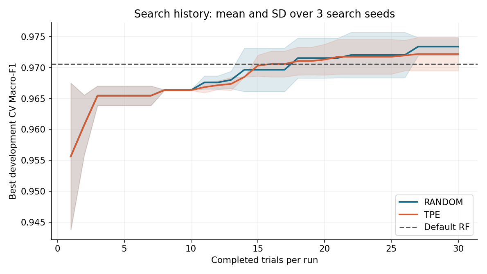
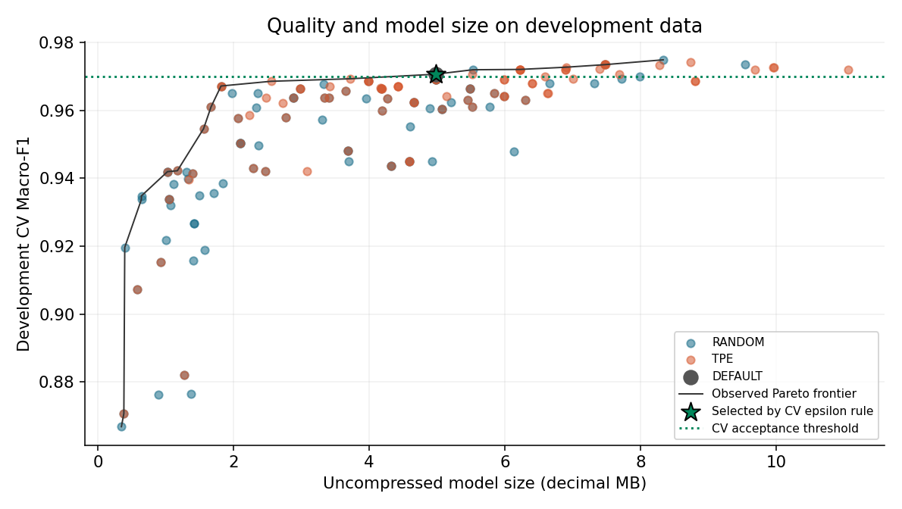
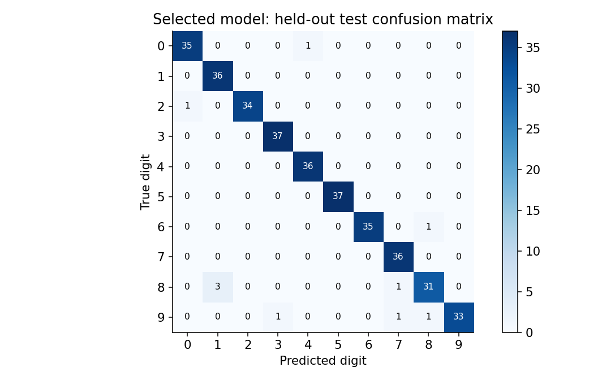

# Digits Random Forest Optimization

**Đồ án cá nhân môn Nhập môn tối ưu hóa.** Tối ưu siêu tham số Random Forest
cho nhận dạng chữ số viết tay, so sánh Random Search với Optuna TPE và chọn
mô hình nhỏ theo một giới hạn suy giảm Macro-F1 validation định trước.

Repo gồm code, notebook có kết quả, log thực nghiệm và mô hình đã huấn luyện.
Theo phạm vi nộp hiện tại, không có báo cáo Word/PDF hoặc slide.

## Chạy nhanh trên Windows

Cần Python 3.12 và Internet cho lần cài thư viện đầu tiên. Sau khi cài thư viện,
dataset có sẵn trong scikit-learn, không cần tài khoản/API key hoặc GPU.

Mở PowerShell tại thư mục chứa README này và chạy:

```powershell
powershell -ExecutionPolicy Bypass -File .\setup.ps1 -Notebook
.\.venv\Scripts\python.exe demo.py --index 123
.\.venv\Scripts\python.exe -m src.validation
.\.venv\Scripts\python.exe -m unittest discover -s tests -v
```

`-ExecutionPolicy Bypass` chỉ áp dụng cho tiến trình chạy script này, không sửa
chính sách máy. Có thể bỏ `-Notebook` nếu chỉ chạy các script Python.
Sau khi setup, nhấp đúp `run_demo.bat` cũng chạy demo được.

Mở notebook:

```powershell
.\.venv\Scripts\jupyter-lab.exe notebooks\optimization_walkthrough.ipynb
```

Chọn kernel **Python (Digits RF)**. Run All đọc kết quả có sẵn và kiểm chứng;
không tự chạy lại toàn bộ quá trình tìm kiếm.

Chạy lại thực nghiệm đầy đủ vào một thư mục MỚI:

```powershell
.\.venv\Scripts\python.exe run_experiment.py --output results/reproduction-01
```

Lần sau dùng `results/reproduction-02` hoặc tên mới. Script từ chối ghi đè một
thư mục kết quả không trống. Lịch sử JSON được lưu sau từng trial, nhưng pipeline
không hỗ trợ resume: một lần chạy bị gián đoạn cần chạy lại vào thư mục mới.
Thời gian thực tế phụ thuộc CPU. Không cần chạy lại HPO để sử dụng demo.

Trên Linux/macOS, tạo venv bằng `python3.12 -m venv .venv`, cài
`pip install -r requirements-notebook.txt` bằng Python trong venv và đăng ký
kernel với `python -m ipykernel install --prefix .venv --name digits-rf`.
Các script Python giữ nguyên, riêng hai script tiện ích Windows chỉ dùng trên Windows.

## Problem

Ảnh đầu vào là ảnh chữ số 8x8 có 64 đặc trưng cường độ. Mục tiêu là chọn cấu
hình Random Forest dự đoán tốt trong ngân sách tìm kiếm hữu hạn, rồi xác định
mô hình nhỏ có chất lượng gần điểm validation tốt nhất đã quan sát.

Hai câu hỏi thực nghiệm:

1. Cùng 30 trials mỗi run, Random Search và TPE đạt Macro-F1 CV và độ ổn định ra sao?
2. Chấp nhận giảm tối đa 0.005 Macro-F1 CV tuyệt đối, có thể chọn mô hình nhỏ đến mức nào?

## Optimization Formulation

Biến quyết định `x = (n_estimators, max_depth, min_samples_leaf, max_features)`.

| Biến | Miền tìm kiếm | Ý nghĩa |
|---|---|---|
| n_estimators | 50, 75, 100, 125, 150, 175, 200 | Số cây |
| max_depth | 5, 10, 15, 20, None | Độ sâu tối đa, None là không giới hạn |
| min_samples_leaf | 1, 2, 3, 4 | Số mẫu tối thiểu ở lá |
| max_features | sqrt, log2, half, all | Số đặc trưng xét khi chia nhánh |

`half` ánh xạ sang 0.5, `all` ánh xạ sang 1.0 của scikit-learn. Miền này có
7 x 5 x 4 x 4 = **560 cấu hình**. Mỗi phương pháp chỉ dùng 30 trials/run,
bao gồm cả những cấu hình lấy mẫu trùng nhau.

Hàm mục tiêu chính:

```text
maximize f(x) = (1/K) * sum(MacroF1(y_validation_k, prediction_k(x))), K = 3
subject to x in the search space and 30 completed evaluations per run
```

Macro-F1 là trung bình F1 của 10 lớp, cho mỗi lớp trọng số bằng nhau.
Hàm mục tiêu không dùng độ chính xác test, kích thước hoặc latency để hướng
dẫn TPE. Kích thước và latency được đo để phân tích và ra quyết định tiếp theo.

Quy tắc chọn mô hình cuối, **định trước khi đánh giá test**:

```text
minimize model_bytes(x)
subject to x being an observed feasible candidate
           f(x) >= max_observed_CV_F1 - epsilon
epsilon = 0.005
```

Nếu bằng kích thước, ưu tiên điểm CV cao hơn, sau đó dùng thứ tự cố định để
chọn nhất quán. Baseline cũng thuộc tập ứng viên. Đây là quyết định theo epsilon
trên các cấu hình đã quan sát, không phải chứng minh tìm được tối ưu toàn cục.
0.005 nghĩa là 0.5 điểm phần trăm F1 tuyệt đối, không phải giảm 0.5% tương đối.

## Dataset

`sklearn.datasets.load_digits()` cung cấp 1.797 mẫu, 10 lớp, 64 đặc trưng,
cường độ trong [0,16]. Đây là Digits 8x8, không phải MNIST. Nguồn và attribution
ở [data/README.md](data/README.md). Không cần tải raw data riêng.

Tiền xử lý chỉ dùng vector 64 pixel do loader trả về. Không chuẩn hóa vì Random
Forest không yêu cầu bước này. Không học preprocessing từ toàn bộ dataset.

## Method and Experimental Protocol

- Baseline: tham số học mặc định của `RandomForestClassifier`, chỉ cố định
  `random_state=123`, `n_jobs=1`.
- Random Search: `optuna.samplers.RandomSampler`.
- Phương pháp chính: `optuna.samplers.TPESampler`, 10 startup trials ngẫu nhiên.
  TPE phân chia kết quả lịch sử theo chất lượng và dùng ước lượng mật độ của
  hai nhóm để đề xuất vùng cấu hình triển vọng cho trial tiếp theo.
- Giữ riêng 20% dữ liệu test bằng stratified split, seed 42. Development có
  1.437 mẫu, test có 360 mẫu. Tạo 3 stratified folds trong development, CV seed 42.
- Hai phương pháp dùng cùng folds, metric, miền biến, 30 trials, không pruning.
  Thực hiện mỗi phương pháp với search seeds 11,22,33, tổng **180 search trials**.
- RF seed giữ nguyên 123 ở mọi cấu hình. Mean ± SD qua search seeds mô tả
  độ biến thiên của tìm kiếm, không bao gồm bất định do chia dữ liệu/RF seed.
- Trong mỗi trial: train/evaluate 3 folds, refit trên development để đo kích
  thước và thời gian predict. Tổng 540 lần fit CV cho search, cộng 180 refits,
  baseline và các lần fit đại diện cuối.
- Chọn trước 4 đại diện: default, Random tốt nhất theo CV, TPE tốt nhất theo CV,
  và mô hình nhỏ theo epsilon. Lưu `selection.json` trước khi đọc giá trị test.
  Đánh giá test của 4 đại diện một lần sau khi khóa quyết định. Không thay
  cấu hình hoặc chọn phương pháp bằng điểm test.
- Kích thước: byte stream joblib không nén, MB = 1.000.000 bytes. Đây là dung
  lượng serialized model, không phải RAM peak hoặc tổng kích thước thư viện.
- Profiling: batch 256 mẫu development cố định, 3 warmups, 15 lần lặp,
  ghi median và p95. `ms_per_sample` là batch time chia 256, không phải
  single-request latency. `cv_seconds` chỉ tính ba fits CV và scoring;
  thời gian toàn pipeline train/evaluate nằm trong `run_manifest.json`.

## Key Results

<!-- RESULTS_START -->

| Model | CV Macro-F1 | Test Macro-F1 | Test accuracy | Size MB |
|---|---:|---:|---:|---:|
| default | 0.97062 | 0.97179 | 0.97222 | 4.976 |
| random | 0.97485 | 0.97463 | 0.97500 | 8.333 |
| tpe | 0.97414 | 0.97179 | 0.97222 | 8.731 |
| selected | 0.97062 | 0.97179 | 0.97222 | 4.976 |

Các kết quả trên đến từ thực nghiệm thật với 180 search trials và một baseline.

| Search method | Best CV Macro-F1 mean | SD over search seeds | Mean CV search seconds |
|---|---:|---:|---:|
| random | 0.97340 | 0.00146 | 48.75 |
| tpe | 0.97221 | 0.00270 | 40.47 |

Trong lần chạy này, mô hình **mặc định vẫn là lựa chọn theo quy tắc epsilon**. Điểm CV 0.97062 nằm trong ngưỡng 0.96985; kích thước 4.976 MB nhỏ nhất trong nhóm đáp ứng ngưỡng. So với cấu hình có điểm CV cao nhất (random), mô hình được chọn nhỏ hơn **40.28%**, với chênh lệch CV **0.00423**. Không điều chỉnh quy tắc chỉ để chọn một mô hình tuned.

Random Search có điểm CV trung bình tốt nhất cao hơn TPE trong ba search seeds của lần chạy này. Kết quả không chứng minh Random Search luôn tốt hơn TPE. Không dùng thứ hạng trên test để chọn cấu hình.

Thời gian train/evaluate thực tế: **431.2 giây** trên máy được ghi trong `results/run_manifest.json`. Kiểm chứng đạt **401 checks**, gồm tính lại metric và dự đoán từ model đã lưu.

<!-- RESULTS_END -->







## How to Run

```powershell
# Đọc và kiểm tra bộ kết quả đã có
.\.venv\Scripts\python.exe -m src.validation

# Vẽ lại biểu đồ, tính lại bảng từ logs, không retrain
.\.venv\Scripts\python.exe -m src.analysis

# Tìm kiếm đầy đủ trong một thư mục mới
.\.venv\Scripts\python.exe run_experiment.py --config configs/experiment.json --output results/reproduction-01

# Kiểm tra một bộ thực nghiệm chạy lại
.\.venv\Scripts\python.exe -m src.validation --output results/reproduction-01

# Demo từ sample hoặc CSV ma trận pixel 8x8 với giá trị 0..16
.\.venv\Scripts\python.exe demo.py --index 123
.\.venv\Scripts\python.exe demo.py --pixels my_digit.csv

# Bộ kiểm tra protocol
.\.venv\Scripts\python.exe -m unittest discover -s tests -v
```

`demo.py --pixels` giả định CSV đã được biến đổi đúng thành ảnh Digits 8x8.
Script không thực hiện OCR trên ảnh chụp. CLI in ảnh ASCII, lớp dự đoán và top 3
xác suất của RF; các xác suất chưa được calibration.

## Repository Structure

```text
digits-rf-optimization/
  configs/experiment.json           # Budget, seeds, search space, epsilon
  src/common.py                    # Config, data split, RF construction
  src/experiment.py                # CV, Random/TPE, locked selection, test
  src/analysis.py                  # Summaries, observed Pareto, figures
  src/validation.py                # Independent result integrity checks
  run_experiment.py                # Main CLI
  demo.py                          # Predict with the saved model
  setup.ps1                        # Local Windows venv and installation
  run_demo.bat                     # Double-click demo after setup
  notebooks/optimization_walkthrough.ipynb
  scripts/build_notebook.py         # Rebuild the walkthrough source
  tests/test_protocol.py            # Isolation, selection, baseline, Pareto
  data/README.md                   # Provenance and preprocessing
  results/
    run_manifest.json              # Actual environment, config, timestamps
    split_indices.json             # Auditable global split/CV indices
    trials.json, trials.csv         # All 180 trials plus baseline
    optuna_*.csv                   # Native per-study trial histories
    baseline.json
    selection.json                 # Locked decision before test evaluation
    final_metrics.csv
    test_predictions.csv           # Source of final test metrics
    best_per_seed.csv, search_summary.csv
    pareto_candidates.csv, epsilon_sensitivity.csv
    classification_*.json, confusion_matrix.csv
    key_results.json, metrics_table.md, validation.json
    models/selected.joblib
    figures/*.png
  requirements.txt, requirements-lock.txt, requirements-notebook.txt
  .gitignore, LICENSE, README.md
```

## Limitations

Một dataset nhỏ, một test split và 3 search seeds chưa đủ để khẳng định một
phương pháp tốt hơn trên mọi bài toán. HPO có thể thích nghi quá mức với CV;
test chỉ cung cấp một đánh giá held-out cho protocol hiện tại. Dải ±SD không
phải confidence interval. Quy tắc epsilon thể hiện ưu tiên triển khai, không
chứng minh tương đương thống kê. Sensitivity chỉ tái chọn trên các logs đã lưu,
không điều chỉnh epsilon theo điểm test. Thời gian chạy/latency thay đổi theo
phần cứng, tải nền và phiên bản thư viện. Kết quả trên ảnh điện thoại hoặc chữ
viết tay ngoài phân phối Digits chưa được kiểm chứng. Mô hình giữ nguyên train
development 80% để các dự đoán test và model bàn giao khớp nhau.

## GitHub Portfolio

Code sẵn sàng để đưa lên repo `digits-rf-optimization`. Gợi ý About:
"Random Forest hyperparameter optimization on Digits with fair search budgets
and a validation-based model-size decision."

Topics: `optimization`, `machine-learning`, `random-forest`, `optuna`,
`hyperparameter-optimization`, `reproducibility`.

Tạo repo public trên tài khoản của bạn, sau đó tại thư mục project:

```bash
git init
git add .
git commit -m "Add reproducible Digits RF optimization experiment"
git branch -M main
git remote add origin YOUR_GITHUB_REPOSITORY_URL
git push -u origin main
```

Thay URL bằng URL repo thực tế. Không đưa `.venv` lên GitHub. Commit các cập
nhật thực tế khi bạn học, chỉnh config hoặc cải tiến project. Bộ code này
không giả lập lịch sử làm việc trong 5 tuần và chưa tự tạo repo GitHub public.
Yêu cầu về GitHub/commit history cần xác nhận theo hướng dẫn mới nhất của cô.

## AI assistance

Codex hỗ trợ tổ chức mã nguồn, viết notebook, thiết lập thực nghiệm và kiểm tra
kết quả. Số liệu trong repo sinh từ các lần chạy Python thực tế và được kiểm
tra lại từ logs, predictions và model. Người nộp cần tự chạy, đọc và giải thích
được từng phần. Kiểm chứng tự động không thay thế việc hiểu nguyên lý TPE,
Macro-F1, ràng buộc, trade off và thiết kế đánh giá.

## References

- [Digits loader](https://scikit-learn.org/stable/modules/generated/sklearn.datasets.load_digits.html)
- [UCI Optical Recognition of Handwritten Digits](https://archive.ics.uci.edu/dataset/80/optical+recognition+of+handwritten+digits)
- [RandomForestClassifier](https://scikit-learn.org/stable/modules/generated/sklearn.ensemble.RandomForestClassifier.html)
- [Optuna samplers](https://optuna.readthedocs.io/en/stable/reference/samplers/index.html)

Code license: MIT. Dataset attribution and license remain separate.
