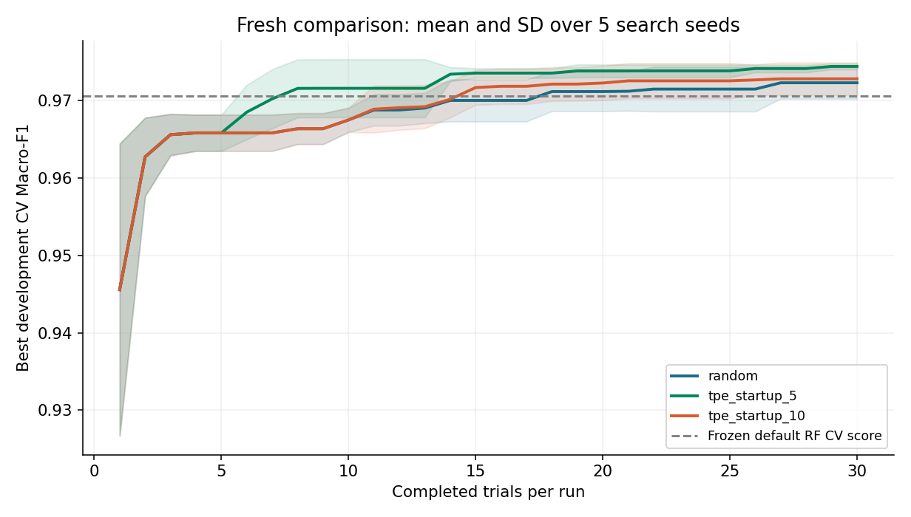
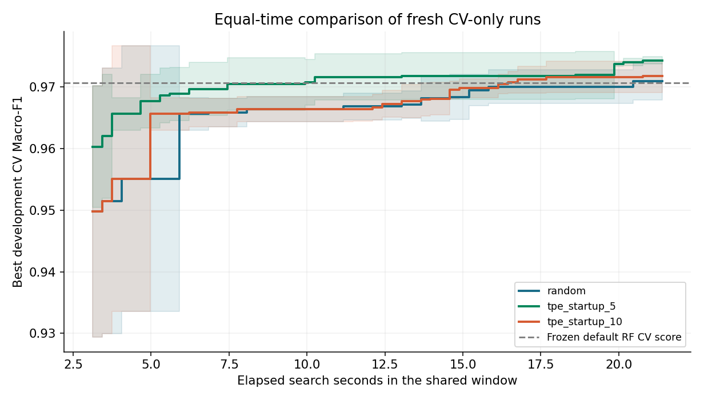
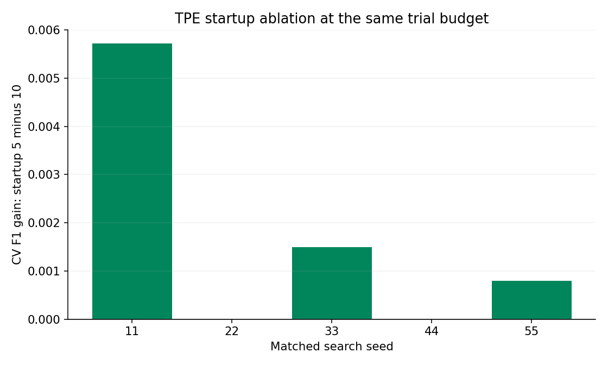
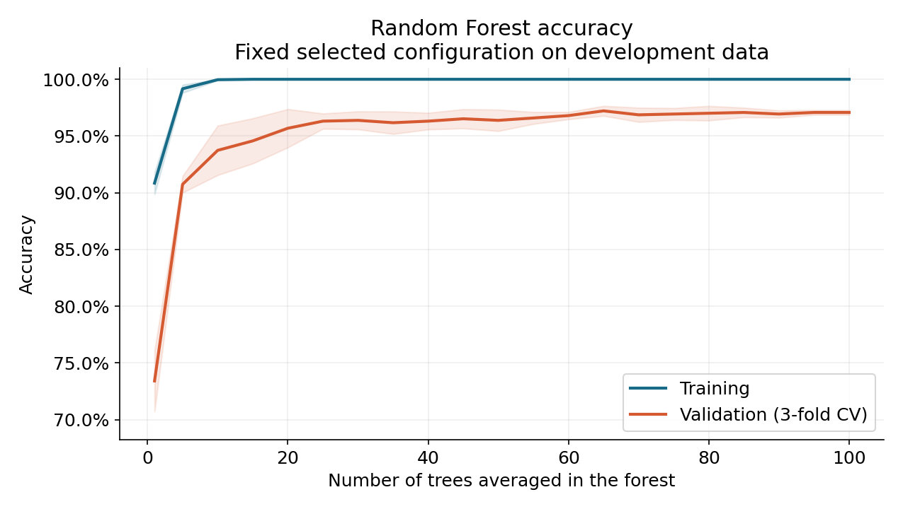
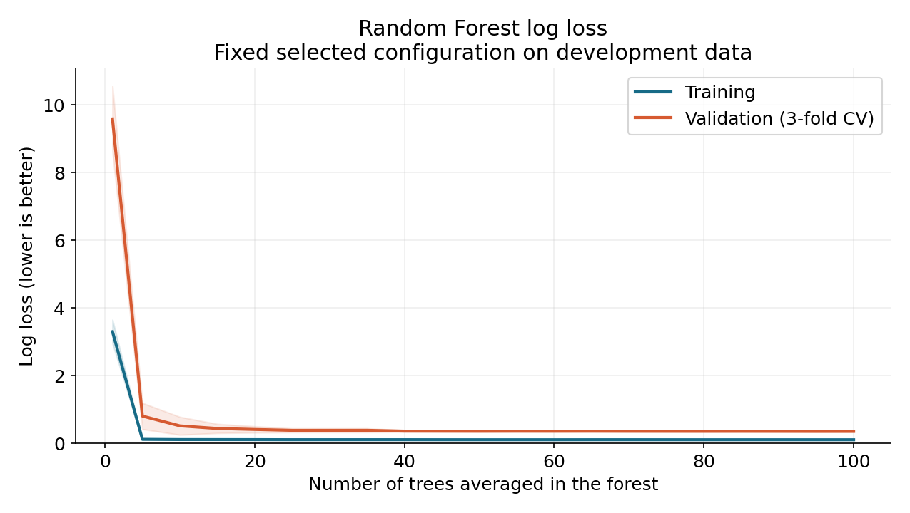
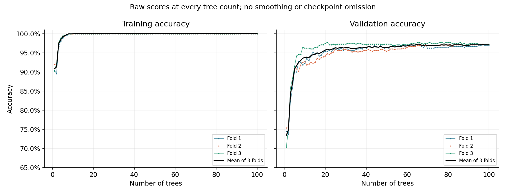
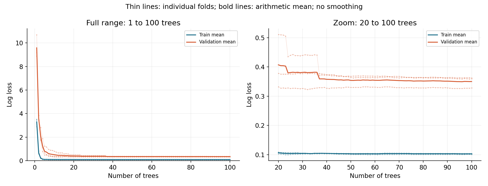

# Digits Random Forest Optimization

[](https://github.com/TienMoi79/digits-rf-optimization/actions/workflows/ci.yml)

**Đồ án cá nhân môn Nhập môn tối ưu hóa.** Tối ưu siêu tham số Random Forest
cho nhận dạng chữ số viết tay, so sánh Random Search với Optuna TPE và chọn
mô hình nhỏ theo một giới hạn suy giảm Macro-F1 validation định trước.

Repo gồm code, notebook có kết quả, log thực nghiệm và mô hình đã huấn luyện.
Phần mở rộng so sánh 5 search seeds, TPE startup 5/10 và ngân sách trials/thời gian;
kết quả test của thí nghiệm ban đầu được bảo toàn.
Theo phạm vi nộp hiện tại, không có báo cáo Word/PDF hoặc slide.

## Chạy nhanh trên Windows

Cần Python 3.12 và Internet cho lần cài thư viện đầu tiên. Sau khi cài thư viện,
dataset có sẵn trong scikit-learn, không cần tài khoản/API key hoặc GPU.

Mở PowerShell tại thư mục chứa README này và chạy:

```powershell
powershell -ExecutionPolicy Bypass -File .\setup.ps1 -Notebook
.\.venv\Scripts\python.exe demo.py --index 123
.\.venv\Scripts\python.exe -m src.validation
.\.venv\Scripts\python.exe -m unittest discover -s tests -v
```

`-ExecutionPolicy Bypass` chỉ áp dụng cho tiến trình chạy script này, không sửa
chính sách máy. Có thể bỏ `-Notebook` nếu chỉ chạy các script Python.
Sau khi setup, nhấp đúp `run_demo.bat` cũng chạy demo được.

Mở notebook:

```powershell
.\.venv\Scripts\jupyter-lab.exe notebooks\robustness_study.ipynb
```

Chọn kernel **Python (Digits RF)**. Notebook `optimization_walkthrough.ipynb`
lưu thí nghiệm ban đầu; `robustness_study.ipynb` trình bày phần mở rộng.
Run All đọc kết quả có sẵn và kiểm chứng;
không tự chạy lại toàn bộ quá trình tìm kiếm.

Chạy lại thực nghiệm đầy đủ vào một thư mục MỚI:

```powershell
.\.venv\Scripts\python.exe run_experiment.py --output results/reproduction-01
```

Lần sau dùng `results/reproduction-02` hoặc tên mới. Script từ chối ghi đè một
thư mục kết quả không trống. Lịch sử JSON được lưu sau từng trial, nhưng pipeline
không hỗ trợ resume: một lần chạy bị gián đoạn cần chạy lại vào thư mục mới.
Thời gian thực tế phụ thuộc CPU. Không cần chạy lại HPO để sử dụng demo.

Trên Linux/macOS, tạo venv bằng `python3.12 -m venv .venv`, cài
`pip install -r requirements-notebook.txt` bằng Python trong venv và đăng ký
kernel với `python -m ipykernel install --prefix .venv --name digits-rf`.
Các script Python giữ nguyên, riêng hai script tiện ích Windows chỉ dùng trên Windows.

## Problem

Ảnh đầu vào là ảnh chữ số 8x8 có 64 đặc trưng cường độ. Mục tiêu là chọn cấu
hình Random Forest dự đoán tốt trong ngân sách tìm kiếm hữu hạn, rồi xác định
mô hình nhỏ có chất lượng gần điểm validation tốt nhất đã quan sát.

Hai câu hỏi thực nghiệm:

1. Cùng 30 trials mỗi run, Random Search và TPE đạt Macro-F1 CV và độ ổn định ra sao?
2. Chấp nhận giảm tối đa 0.005 Macro-F1 CV tuyệt đối, có thể chọn mô hình nhỏ đến mức nào?

## Optimization Formulation

Biến quyết định `x = (n_estimators, max_depth, min_samples_leaf, max_features)`.

| Biến | Miền tìm kiếm | Ý nghĩa |
|---|---|---|
| n_estimators | 50, 75, 100, 125, 150, 175, 200 | Số cây |
| max_depth | 5, 10, 15, 20, None | Độ sâu tối đa, None là không giới hạn |
| min_samples_leaf | 1, 2, 3, 4 | Số mẫu tối thiểu ở lá |
| max_features | sqrt, log2, half, all | Số đặc trưng xét khi chia nhánh |

`half` ánh xạ sang 0.5, `all` ánh xạ sang 1.0 của scikit-learn. Miền này có
7 x 5 x 4 x 4 = **560 cấu hình**. Mỗi phương pháp chỉ dùng 30 trials/run,
bao gồm cả những cấu hình lấy mẫu trùng nhau.

Hàm mục tiêu chính:

```text
maximize f(x) = (1/K) * sum(MacroF1(y_validation_k, prediction_k(x))), K = 3
subject to x in the search space and 30 completed evaluations per run
```

Macro-F1 là trung bình F1 của 10 lớp, cho mỗi lớp trọng số bằng nhau.
Hàm mục tiêu không dùng độ chính xác test, kích thước hoặc latency để hướng
dẫn TPE. Kích thước và latency được đo để phân tích và ra quyết định tiếp theo.

Quy tắc chọn mô hình cuối, **định trước khi đánh giá test**:

```text
minimize model_bytes(x)
subject to x being an observed feasible candidate
           f(x) >= max_observed_CV_F1 - epsilon
epsilon = 0.005
```

Nếu bằng kích thước, ưu tiên điểm CV cao hơn, sau đó dùng thứ tự cố định để
chọn nhất quán. Baseline cũng thuộc tập ứng viên. Đây là quyết định theo epsilon
trên các cấu hình đã quan sát, không phải chứng minh tìm được tối ưu toàn cục.
0.005 nghĩa là 0.5 điểm phần trăm F1 tuyệt đối, không phải giảm 0.5% tương đối.

## Dataset

`sklearn.datasets.load_digits()` cung cấp 1.797 mẫu, 10 lớp, 64 đặc trưng,
cường độ trong [0,16]. Đây là Digits 8x8, không phải MNIST. Nguồn và attribution
ở [data/README.md](data/README.md). Không cần tải raw data riêng.

Tiền xử lý chỉ dùng vector 64 pixel do loader trả về. Không chuẩn hóa vì Random
Forest không yêu cầu bước này. Không học preprocessing từ toàn bộ dataset.

## Method and Experimental Protocol

- Baseline: tham số học mặc định của `RandomForestClassifier`, chỉ cố định
  `random_state=123`, `n_jobs=1`.
- Random Search: `optuna.samplers.RandomSampler`.
- Phương pháp chính: `optuna.samplers.TPESampler`, 10 startup trials ngẫu nhiên.
  TPE phân chia kết quả lịch sử theo chất lượng và dùng ước lượng mật độ của
  hai nhóm để đề xuất vùng cấu hình triển vọng cho trial tiếp theo.
- Giữ riêng 20% dữ liệu test bằng stratified split, seed 42. Development có
  1.437 mẫu, test có 360 mẫu. Tạo 3 stratified folds trong development, CV seed 42.
- Hai phương pháp dùng cùng folds, metric, miền biến, 30 trials, không pruning.
  Thực hiện mỗi phương pháp với search seeds 11,22,33, tổng **180 search trials**.
- RF seed giữ nguyên 123 ở mọi cấu hình. Mean ± SD qua search seeds mô tả
  độ biến thiên của tìm kiếm, không bao gồm bất định do chia dữ liệu/RF seed.
- Trong mỗi trial: train/evaluate 3 folds, refit trên development để đo kích
  thước và thời gian predict. Tổng 540 lần fit CV cho search, cộng 180 refits,
  baseline và các lần fit đại diện cuối.
- Chọn trước 4 đại diện: default, Random tốt nhất theo CV, TPE tốt nhất theo CV,
  và mô hình nhỏ theo epsilon. Lưu `selection.json` trước khi đọc giá trị test.
  Đánh giá test của 4 đại diện một lần sau khi khóa quyết định. Không thay
  cấu hình hoặc chọn phương pháp bằng điểm test.
- Kích thước: byte stream joblib không nén, MB = 1.000.000 bytes. Đây là dung
  lượng serialized model, không phải RAM peak hoặc tổng kích thước thư viện.
- Profiling: batch 256 mẫu development cố định, 3 warmups, 15 lần lặp,
  ghi median và p95. `ms_per_sample` là batch time chia 256, không phải
  single-request latency. `cv_seconds` chỉ tính ba fits CV và scoring;
  thời gian toàn pipeline train/evaluate nằm trong `run_manifest.json`.

## Key Results

<!-- RESULTS_START -->

| Model | CV Macro-F1 | Test Macro-F1 | Test accuracy | Size MB |
|---|---:|---:|---:|---:|
| default | 0.97062 | 0.97179 | 0.97222 | 4.976 |
| random | 0.97485 | 0.97463 | 0.97500 | 8.333 |
| tpe | 0.97414 | 0.97179 | 0.97222 | 8.731 |
| selected | 0.97062 | 0.97179 | 0.97222 | 4.976 |

Các kết quả trên đến từ thực nghiệm thật với 180 search trials và một baseline.

| Search method | Best CV Macro-F1 mean | SD over search seeds | Mean CV search seconds |
|---|---:|---:|---:|
| random | 0.97340 | 0.00146 | 48.75 |
| tpe | 0.97221 | 0.00270 | 40.47 |

Trong lần chạy này, mô hình **mặc định vẫn là lựa chọn theo quy tắc epsilon**. Điểm CV 0.97062 nằm trong ngưỡng 0.96985; kích thước 4.976 MB nhỏ nhất trong nhóm đáp ứng ngưỡng. So với cấu hình có điểm CV cao nhất (random), mô hình được chọn nhỏ hơn **40.28%**, với chênh lệch CV **0.00423**. Không điều chỉnh quy tắc chỉ để chọn một mô hình tuned.

Random Search có điểm CV trung bình tốt nhất cao hơn TPE trong ba search seeds của lần chạy này. Kết quả không chứng minh Random Search luôn tốt hơn TPE. Không dùng thứ hạng trên test để chọn cấu hình.

Thời gian train/evaluate thực tế: **431.2 giây** trên máy được ghi trong `results/run_manifest.json`. Kiểm chứng đạt **401 checks**, gồm tính lại metric và dự đoán từ model đã lưu.

<!-- RESULTS_END -->


## Development-only extension

Thiết kế phần mở rộng được lưu trong `configs/robustness.json` trước khi chạy:
Random Search, TPE startup 5, TPE startup 10; seeds 11,22,33,44,55;
30 trials/method/seed, tổng 450 trials và 1.350 lần fit CV, cộng 3 fits baseline.
Miền tìm kiếm, development, folds, Macro-F1 và RF seed giữ nguyên như thí nghiệm gốc.

Mọi study chạy mới, tuần tự, n_jobs=1 trong cùng phiên. Thứ tự phương pháp xoay
vòng theo seed để tránh luôn chạy một phương pháp cuối cùng. Không ghép thời gian
của lần chạy cũ với lần chạy mới. Chỉ thực hiện CV, không refit/profiling mô hình
hoặc đánh giá thêm trên test. Mô hình demo vẫn là model của thí nghiệm gốc.

Các checkpoint 10,20,30 chỉ dùng prefix trials tương ứng. Đường theo thời gian
sử dụng thời điểm hoàn tất trial trong miền thời gian giao nhau của tất cả runs,
không nội suy score, điền ngược hoặc ngoại suy sau khi study kết thúc.
Elapsed time gồm sampler, CV, bookkeeping và chi phí ghi log trước đó.
Không so trực tiếp thời gian CV-only này với tổng runtime pipeline ban đầu.

Ablation ghép startup 5 và 10 theo cùng seed. Delta là best CV F1 của startup 5
trừ startup 10 tại cùng ngân sách 30. Mean và SD qua search seeds mang tính mô tả,
không phải khoảng tin cậy trên các dataset hoặc kiểm định ý nghĩa thống kê.

Các artifact gốc được kiểm tra SHA-256 trước/sau studies và khi xác thực kết quả.
Hash văn bản chuẩn hóa CRLF thành LF để tương thích checkout Windows/Linux;
model nhị phân được hash nguyên bytes. `results/validation.json` là chẩn đoán
có thể ghi lại khi kiểm tra nên không nằm trong tập kết quả đóng băng.

<!-- ROBUSTNESS_RESULTS_START -->

| Method | Trials/run | Seeds | Best CV F1 mean ± SD | Elapsed mean ± SD (s) | Elapsed median (s) |
|---|---:|---:|---:|---:|---:|
| random | 10 | 5 | 0.96751 ± 0.00157 | 13.74 ± 3.95 | 11.74 |
| random | 20 | 5 | 0.97118 ± 0.00253 | 32.32 ± 17.94 | 26.41 |
| random | 30 | 5 | 0.97231 ± 0.00207 | 53.72 ± 41.34 | 35.45 |
| tpe_startup_10 | 10 | 5 | 0.96751 ± 0.00157 | 13.56 ± 4.29 | 11.28 |
| tpe_startup_10 | 20 | 5 | 0.97228 ± 0.00223 | 27.55 ± 18.08 | 20.72 |
| tpe_startup_10 | 30 | 5 | 0.97282 ± 0.00210 | 138.27 ± 200.84 | 28.31 |
| tpe_startup_5 | 10 | 5 | 0.97159 ± 0.00375 | 11.81 ± 4.64 | 10.67 |
| tpe_startup_5 | 20 | 5 | 0.97385 ± 0.00083 | 28.12 ± 18.21 | 21.35 |
| tpe_startup_5 | 30 | 5 | 0.97442 ± 0.00039 | 48.90 ± 39.84 | 33.27 |

Ở 30 trials/run, **tpe_startup_5** có điểm CV trung bình cao nhất trong năm search seeds của lần chạy này. TPE startup 5 hơn startup 10 ở **3/5 seed**, hòa **2/5**; chênh lệch CV F1 trung bình là **0.00160** (0.160 điểm phần trăm tuyệt đối). Đây là bằng chứng mô tả cho protocol và ngân sách hiện tại, chưa phải kết luận tổng quát hoặc kiểm định ý nghĩa thống kê.

Thêm hai search seeds làm thứ hạng CV trung bình của Random Search và TPE startup 10 đổi so với thí nghiệm ba seeds ban đầu. Điều này cho thấy cần xem độ ổn định qua nhiều seed thay vì chỉ dựa vào một nhóm nhỏ.

**Giới hạn phép đo thời gian:** TPE startup 10 ở seed 44 mất 490.17 giây, trong khi các seed còn lại của cùng phương pháp mất khoảng 24.79 đến 120.37 giây. Phần thời gian CV cũng biến động lớn. Logs không đủ để xác định nguyên nhân; vì vậy thời gian là kết quả đo của phiên chạy này, cần lặp trên môi trường ít biến động để đánh giá tốc độ chắc chắn hơn. Bảng giữ nguyên mọi run, kèm SD và median để thể hiện mức biến động.

Phiên chạy hoàn tất mất **1205.6 giây**. Kiểm chứng đạt **3278 checks**, bảo toàn **26 artifacts gốc**, và không đánh giá thêm mô hình mới trên test.

<!-- ROBUSTNESS_RESULTS_END -->







## Accuracy and loss curves

Two diagnostic plots use the fixed selected Random Forest in the original
three development folds. The horizontal axis is the number of trees averaged
in the forest, not epochs or hyperparameter-search trials. Bands show one SD
across folds. Log loss measures predictive probabilities; the trees themselves
use the default Gini split criterion. No new test evaluation is performed.

```powershell
.\.venv\Scripts\python.exe -m src.tree_diagnostics
```

Logs: `results/tree_diagnostics/metrics_per_fold.csv` and `metrics_summary.csv`.
The script checks that prefix probability accumulation matches the full forest
and that final CV Macro-F1 reproduces the originally published fold scores.
At 100 trees, mean training accuracy is 1.00000 and validation accuracy 0.97077;
mean train/validation log losses are 0.10277/0.35004. These are development CV
metrics, separate from the frozen 97.22% held-out test accuracy.





### Kiểm tra độc lập dữ liệu và đường cong

Biểu đồ trên chỉ vẽ 21 mốc số cây và trung bình của 3 folds. Không dùng spline,
bộ lọc hoặc sửa điểm số, nhưng phép lấy trung bình và thang loss toàn dải làm
dao động nhỏ khó nhìn thấy. Đây là đường theo **số cây**, không phải lịch sử
accuracy/loss theo epoch của mạng nơ-ron. Log loss là chỉ số đánh giá xác suất,
không phải hàm mà Random Forest trực tiếp tối ưu khi xây cây.

Chạy kiểm tra độc lập (cần Internet để đối chiếu nguồn UCI):

```powershell
.\.venv\Scripts\python.exe -m src.curve_audit
```

`src/curve_audit.py` tải file gốc `optdigits.tes` từ
[UCI](https://archive.ics.uci.edu/dataset/80/optical+recognition+of+handwritten+digits),
đối chiếu từng pixel và nhãn với `load_digits()`, tái tạo split/folds không qua
helper chia dữ liệu của project, rồi fit mới 63 Random Forest tại các mốc đã
công bố. Accuracy được tính bằng tỷ lệ nhãn đúng, log loss bằng công thức
trực tiếp từ xác suất nhãn thật. Toàn bộ 126 dòng kết quả theo fold/split và
mean/SD đều tái tạo khớp; sai lệch số thực lớn nhất là **1.78e-15**.
Hash trước/sau xác nhận bộ kết quả, model và hai biểu đồ ban đầu được giữ nguyên.
Không đánh giá thêm trên test.

Bản chi tiết dưới đây giữ đủ 100 mốc và đường của từng fold. Accuracy validation
trung bình có **31 bước giảm**, loss validation có **34 bước tăng**: đường thực
tế có dao động. Loss ở một cây lớn vì lần lượt 122/118/142 mẫu validation có
xác suất lớp thật bằng 0; phép tính log loss chặn xác suất ở machine epsilon.
Khung zoom hiển thị rõ vùng loss nhỏ sau 20 cây, bên cạnh khung toàn dải.

Training accuracy 100% ở cuối là điểm trên chính dữ liệu đã fit, với cây không
giới hạn độ sâu và `min_samples_leaf=1`; không có nghĩa validation/test đạt
100% hay không có overfitting. Đối chứng bổ sung fit trên **bản sao nhãn train
được hoán vị**, chỉ để kiểm tra pipeline: accuracy validation trung bình 11.48%,
gần mức đoán ngẫu nhiên 10 lớp. Dữ liệu và nhãn của thí nghiệm chính không đổi.





Chi tiết kiểm tra và hashes: `results/curve_audit/audit_checks.json`.
Các CSV đi kèm lưu điểm fit độc lập, điểm tại mỗi số cây và đối chứng riêng.
Đây là bằng chứng kiểm tra khả năng tái tạo, không phải bảo đảm mọi dạng sai
lệch đều đã bị loại trừ. CV đã được dùng khi chọn cấu hình nên các đường này
là chẩn đoán trên development, không phải ước lượng mới trên tập test độc lập.

## Automated checks

GitHub Actions chạy trên Windows và Ubuntu, Python 3.12 trong venv riêng, sau
mỗi push/pull request. Workflow cài dependencies đã khóa, chạy `pip check`,
unit tests, xác thực kết quả gốc và phần mở rộng đã công bố, rồi chạy smoke test
18 trials bằng `configs/robustness-smoke.json`. Smoke results nằm trong thư mục
tạm của runner, không thay thế bộ kết quả chính thức 450 trials.

## How to Run

```powershell
# Đọc và kiểm tra bộ kết quả đã có
.\.venv\Scripts\python.exe -m src.validation

# Vẽ lại biểu đồ, tính lại bảng từ logs, không retrain
.\.venv\Scripts\python.exe -m src.analysis

# Chạy lại phần mở rộng development-only vào thư mục mới
.\.venv\Scripts\python.exe run_robustness.py --output results/robustness-reproduction-01

# Kiểm tra phần mở rộng đã lưu
.\.venv\Scripts\python.exe -m src.robustness_validation

# Tìm kiếm pipeline ban đầu trong một thư mục mới
.\.venv\Scripts\python.exe run_experiment.py --config configs/experiment.json --output results/reproduction-01

# Kiểm tra một bộ thực nghiệm chạy lại
.\.venv\Scripts\python.exe -m src.validation --output results/reproduction-01

# Demo từ sample hoặc CSV ma trận pixel 8x8 với giá trị 0..16
.\.venv\Scripts\python.exe demo.py --index 123
.\.venv\Scripts\python.exe demo.py --pixels my_digit.csv

# Bộ kiểm tra protocol
.\.venv\Scripts\python.exe -m unittest discover -s tests -v
```

`demo.py --pixels` giả định CSV đã được biến đổi đúng thành ảnh Digits 8x8.
Script không thực hiện OCR trên ảnh chụp. CLI in ảnh ASCII, lớp dự đoán và top 3
xác suất của RF; các xác suất chưa được calibration.

## Repository Structure

```text
digits-rf-optimization/
  configs/experiment.json           # Original three-seed experiment
  configs/robustness.json           # Five-seed comparison and startup treatments
  configs/robustness-smoke.json     # Small CI integration budget
  src/common.py                    # Config, data split, RF construction
  src/experiment.py                # CV, Random/TPE, locked selection, test
  src/analysis.py                  # Summaries, observed Pareto, figures
  src/validation.py                # Independent result integrity checks
  run_experiment.py                # Original train/select/test pipeline
  run_robustness.py                # Development-only extension CLI
  src/robustness*.py               # Study runner, analysis and validation
  .github/workflows/ci.yml         # Windows and Ubuntu checks
  demo.py                          # Predict with the saved model
  setup.ps1                        # Local Windows venv and installation
  run_demo.bat                     # Double-click demo after setup
  update_github.ps1                 # Check, commit and push each update
  AGENTS.md                        # Project workflow for future code updates
  figures/*.png                    # Original figures
  figures/robustness/*.png         # Budget and startup ablation figures
  notebooks/optimization_walkthrough.ipynb  # Original experiment
  notebooks/robustness_study.ipynb           # Five-seed extension
  scripts/build_notebook.py         # Rebuild original notebook source
  scripts/build_robustness_notebook.py
  tests/test_robustness.py          # Pairing, prefixes, time, provenance, logging
  tests/test_protocol.py            # Isolation, selection, baseline, Pareto
  data/README.md                   # Provenance and preprocessing
  results/
    run_manifest.json              # Actual environment, config, timestamps
    split_indices.json             # Auditable global split/CV indices
    trials.json, trials.csv         # All 180 trials plus baseline
    optuna_*.csv                   # Native per-study trial histories
    baseline.json
    selection.json                 # Locked decision before test evaluation
    final_metrics.csv
    test_predictions.csv           # Source of final test metrics
    best_per_seed.csv, search_summary.csv
    pareto_candidates.csv, epsilon_sensitivity.csv
    classification_*.json, confusion_matrix.csv
    key_results.json, metrics_table.md, validation.json
    models/selected.joblib
    robustness/                   # New CV-only logs and analysis
      run_manifest.json, baseline_cv.json
      trials.json, trials.csv, optuna_*.csv
      budget_per_seed.csv, budget_summary.csv
      time_budget_per_seed.csv, time_comparison.json
      startup_ablation_pairs.csv, startup_ablation_summary.json
      metrics_table.md, validation.json
  requirements.txt, requirements-lock.txt, requirements-notebook.txt
  .gitignore, LICENSE, README.md
```

## Limitations

Thí nghiệm gốc có 3 search seeds; phần mở rộng có 5 search seeds trên cùng
development và folds. Một dataset nhỏ và một test split chưa đủ để khẳng định
một phương pháp tốt hơn trên mọi bài toán. HPO có thể thích nghi quá mức với CV;
test chỉ cung cấp một đánh giá held-out cho protocol hiện tại. Dải ±SD không
phải confidence interval. Quy tắc epsilon thể hiện ưu tiên triển khai, không
chứng minh tương đương thống kê. Sensitivity chỉ tái chọn trên các logs đã lưu,
không điều chỉnh epsilon theo điểm test. Thời gian chạy/latency thay đổi theo
phần cứng, tải nền và phiên bản thư viện. Kết quả trên ảnh điện thoại hoặc chữ
viết tay ngoài phân phối Digits chưa được kiểm chứng. Mô hình giữ nguyên train
development 80% để các dự đoán test và model bàn giao khớp nhau.

## GitHub Portfolio

Repository public: **https://github.com/TienMoi79/digits-rf-optimization**.
Thư mục hiện tại là Git checkout của repo này. Mã nguồn, notebook, logs và
biểu đồ được quản lý trong cùng repo; môi trường `.venv` và cache được bỏ qua.

Cấu trúc cấp gốc theo hướng dẫn của môn: `src/`, `notebooks/`, `results/`,
`figures/`, `data/`, `README.md`, `requirements.txt` và `.gitignore`.
Phạm vi nộp hiện tại là code và kết quả thực nghiệm.

Mỗi lần hoàn thành một cập nhật, commit và push để GitHub phản ánh đúng bản
đang làm. Lệnh tiện ích trên Windows kiểm tra tests và kết quả trước khi push:

```powershell
powershell -ExecutionPolicy Bypass -File .\update_github.ps1 -Message "Describe the actual update"
```

Hoặc thực hiện thủ công:

```bash
git status
git add .
git commit -m "Describe the actual update"
git push
```

Lịch sử Git bắt đầu từ ngày 13/10/2026. Các commit phản ánh thay đổi thực tế,
không giả lập tiến độ của các tuần trước. Các mốc cập nhật tiếp theo cần tiếp
tục ghi nhận trong quá trình làm project. Cấu trúc và nội dung đã chuẩn bị
không tự thay thế yêu cầu tiến độ mà giảng viên đánh giá.

Topics: `optimization`, `machine-learning`, `random-forest`, `optuna`,
`hyperparameter-optimization`, `reproducibility`.

## AI assistance

Codex hỗ trợ tổ chức mã nguồn, viết notebook, thiết lập thực nghiệm và kiểm tra
kết quả. Số liệu trong repo sinh từ các lần chạy Python thực tế và được kiểm
tra lại từ logs, predictions và model. Người nộp cần tự chạy, đọc và giải thích
được từng phần. Kiểm chứng tự động không thay thế việc hiểu nguyên lý TPE,
Macro-F1, ràng buộc, trade off và thiết kế đánh giá.

## References

- [Digits loader](https://scikit-learn.org/stable/modules/generated/sklearn.datasets.load_digits.html)
- [UCI Optical Recognition of Handwritten Digits](https://archive.ics.uci.edu/dataset/80/optical+recognition+of+handwritten+digits)
- [RandomForestClassifier](https://scikit-learn.org/stable/modules/generated/sklearn.ensemble.RandomForestClassifier.html)
- [Optuna samplers](https://optuna.readthedocs.io/en/stable/reference/samplers/index.html)

Code license: MIT. Dataset attribution and license remain separate.
