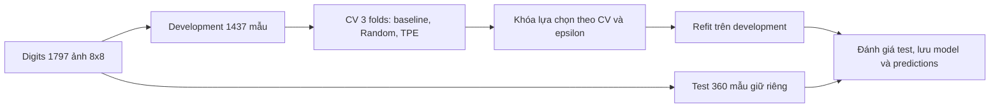

# Digits Random Forest Optimization

[](https://github.com/TienMoi79/digits-rf-optimization/actions/workflows/ci.yml)

Đồ án cá nhân môn **Nhập môn tối ưu hóa**: tối ưu siêu tham số Random Forest
để nhận dạng chữ số Digits, so sánh Random Search với Optuna TPE, rồi chọn
mô hình nhỏ trong ngưỡng giảm Macro-F1 validation đã định trước.

**Chuẩn bị nộp ngày 26/11/2026:** [Cách mở web, demo và lấy bản nộp sạch](docs/nop-bai.md).
Trên máy đã có Python, nhấp đúp `web/start_web.bat` để xem giao diện;
không cần cài thư viện ML chỉ để mở web.

## Mở đúng phần cần dùng

| Bạn muốn xem | Mở file |
|---|---|
| Giao diện web để xem và thử nhận dạng | [Mở Digits Lab](https://digits-rf-lab-tienmoi79.flowypheasant16.chatgpt.site) · [Cách chạy trên máy](web/README.md) |
| Báo cáo Word mới nhất, 11 trang | [Bản ngày 09/11/2026](report/Bao_cao_Train_Validation_Test_Baselines_2026-11-09.docx) |
| Biểu đồ có hai đường train/validation | [Accuracy](figures/train_validation_two_lines/accuracy.png), [Loss](figures/train_validation_two_lines/log_loss.png) |
| Checkpoint và phản hồi của cô | [Mục lục báo cáo](report/README.md) |
| Lịch sử thực hiện và việc còn lại | [PROGRESS.md](PROGRESS.md) |
| Giải thích TPE và tập demo | [Hướng dẫn demo tối ưu](docs/tpe-va-demo-toi-uu.md) |
| Tự chạy tái lập | [Hướng dẫn tuần 10](docs/tu-chay-tai-lap-tuan-10.md) |
| Công thức, protocol, ablation, giới hạn | [Hướng dẫn kỹ thuật đầy đủ](docs/huong-dan-ky-thuat.md) |
| Vị trí code và các bộ kết quả | [Bản đồ thư mục](docs/README.md) |

## Bài toán và pipeline

Biến quyết định là `x = (n_estimators, max_depth, min_samples_leaf, max_features)`:
50–200 cây với bước 25; độ sâu 5/10/15/20/None; số mẫu tối thiểu ở lá 1–4;
số đặc trưng sqrt/log2/half/all. Có 560 cấu hình trong [config gốc](configs/experiment.json).

Mục tiêu: **tối đa mean Macro-F1 qua 3 folds development** trong ngân sách
30 trials/phương pháp/search seed. So sánh RF mặc định, Random Search và TPE
(startup 10), dùng cùng dữ liệu, folds, miền biến và RF seed. Có ba search seeds
11/22/33, tổng 180 search trials. Sau tìm kiếm, chọn model nhỏ nhất trong các
cấu hình khả thi có CV F1 ≥ best CV F1 − **0.005**, bao gồm baseline.



Không chọn hyperparameter bằng test. Seed split/CV là 42, RF seed là 123.
Dataset có 64 đặc trưng pixel, 10 lớp; không cần API key hay GPU.
[Nguồn dữ liệu và tiền xử lý](data/README.md).

## Kết quả gốc

<!-- RESULTS_START -->

| Model | CV Macro-F1 | Test Macro-F1 | Test accuracy | Size MB |
|---|---:|---:|---:|---:|
| default | 0.97062 | 0.97179 | 0.97222 | 4.976 |
| random | 0.97485 | 0.97463 | 0.97500 | 8.333 |
| tpe | 0.97414 | 0.97179 | 0.97222 | 8.731 |
| selected | 0.97062 | 0.97179 | 0.97222 | 4.976 |

Các kết quả trên đến từ thực nghiệm thật với 180 search trials và một baseline.

| Search method | Best CV Macro-F1 mean | SD over search seeds | Mean CV search seconds |
|---|---:|---:|---:|
| random | 0.97340 | 0.00146 | 48.75 |
| tpe | 0.97221 | 0.00270 | 40.47 |

Trong lần chạy này, mô hình **mặc định vẫn là lựa chọn theo quy tắc epsilon**. Điểm CV 0.97062 nằm trong ngưỡng 0.96985; kích thước 4.976 MB nhỏ nhất trong nhóm đáp ứng ngưỡng. So với cấu hình có điểm CV cao nhất (random), mô hình được chọn nhỏ hơn **40.28%**, với chênh lệch CV **0.00423**. Không điều chỉnh quy tắc chỉ để chọn một mô hình tuned.

Random Search có điểm CV trung bình tốt nhất cao hơn TPE trong ba search seeds của lần chạy này. Kết quả không chứng minh Random Search luôn tốt hơn TPE. Không dùng thứ hạng trên test để chọn cấu hình.

Thời gian train/evaluate thực tế: **431.2 giây** trên máy được ghi trong `results/run_manifest.json`. Kiểm chứng đạt **401 checks**, gồm tính lại metric và dự đoán từ model đã lưu.

<!-- RESULTS_END -->

[Search history](figures/search_history.png) · [Quality/size trade-off](figures/quality_size_tradeoff.png) · [Bảng kết quả CSV](results/final_metrics.csv).
Phần mở rộng 450 trials/5 seeds chỉ dùng development. Lần tái lập tuần 10
khớp kết quả của 180 trials gốc; dùng lại cùng test nên không phải đánh giá
độc lập mới. Các hình train/validation dùng số cây, không phải epoch.

## Chạy trên Windows

Mở PowerShell trong folder này. Cần Python 3.12; lần setup đầu cần Internet:

```powershell
powershell -ExecutionPolicy Bypass -File .\setup.ps1 -Notebook
.\.venv\Scripts\python.exe demo.py --index 123
.\.venv\Scripts\python.exe -X utf8 demo_optimization.py replay --seed 11 --checkpoint 15
.\.venv\Scripts\python.exe -m src.validation
```

Sau setup, có thể nhấp đúp `run_demo.bat`. Bỏ `-Notebook` nếu không dùng notebook.
Replay đọc log đã lưu; không huấn luyện lại. Demo nhận ma trận pixel Digits 8×8,
không nhận trực tiếp ảnh chụp điện thoại.

Hai notebook: [thí nghiệm gốc](notebooks/optimization_walkthrough.ipynb) và
[nghiên cứu mở rộng](notebooks/robustness_study.ipynb). Run All mặc định đọc
kết quả có sẵn; hướng dẫn mở kernel và chạy thí nghiệm mới ở
[hướng dẫn kỹ thuật](docs/huong-dan-ky-thuat.md#chạy-nhanh-trên-windows).

Kiểm tra toàn bộ trước khi cập nhật GitHub:

```powershell
powershell -ExecutionPolicy Bypass -File .\update_github.ps1 -Message "Mo ta thay doi thuc te"
```

Lệnh trên kiểm tra rồi commit/push thay đổi; không chạy lại HPO.
Muốn chỉ kiểm tra, chạy từng lệnh ở [mục CI trong tài liệu kỹ thuật](docs/huong-dan-ky-thuat.md#automated-checks).

## Cấu trúc chính

```text
src/          thuật toán, phân tích và kiểm chứng
configs/      cấu hình thí nghiệm đã khóa
notebooks/    hai notebook có kết quả
results/      logs, bảng số liệu, predictions, model và các lần chạy
figures/      biểu đồ sinh từ số liệu
report/       Word mới nhất, checkpoints/, reviews/, updates/, maintenance/
docs/         hướng dẫn kỹ thuật, demo và tái lập
scripts/      dựng notebook, Word, biểu đồ và kiểm tra train accuracy
tests/        kiểm tra protocol, provenance, demo và phân tích
web/          dashboard, biểu đồ tương tác và nhận dạng chữ số trong trình duyệt
```

Các CLI `run_experiment.py`, `run_robustness.py`, `demo.py`,
`demo_optimization.py` ở gốc để giữ lệnh chạy đơn giản. `.venv/` là môi trường
cục bộ và `.git/` là lịch sử; không phải file nộp hay file rác để xóa.
Chi tiết bộ kết quả nào phục vụ phần nào ở [bản đồ thư mục](docs/README.md).

## Tiến độ và giới hạn

Phần kỹ thuật tuần 10 đã hoàn thành ngày 09/11; cập nhật cách vẽ hình ngày
13/11; sắp xếp folder ngày 16/11 và rà soát trước hạn nộp ngày 26/11/2026.
Chưa xác nhận sinh viên tự tái lập, cô duyệt checkpoint hoặc nộp bài.
Trạng thái từng việc được ghi ở [PROGRESS.md](PROGRESS.md).

Train accuracy 100% là điểm in-sample, không đồng nghĩa dự đoán hoàn hảo trên
dữ liệu mới. Có [kiểm tra độc lập train accuracy](report/reviews/kiem-tra-train-accuracy-2026-11-03.md).
Một dataset nhỏ và một test split chưa đủ để kết luận TPE/Random tốt hơn nói chung;
runtime phụ thuộc máy và tải nền. Không sửa số liệu hoặc viết lại lịch sử Git.

Codex hỗ trợ code, thực nghiệm và kiểm tra; sinh viên cần tự chạy và giải thích
được bài toán, thuật toán và kết quả. Code có giấy phép [MIT](LICENSE);
nguồn và giấy phép dataset được ghi riêng ở [data/README.md](data/README.md).
