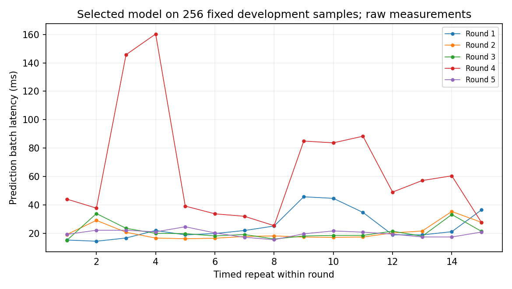
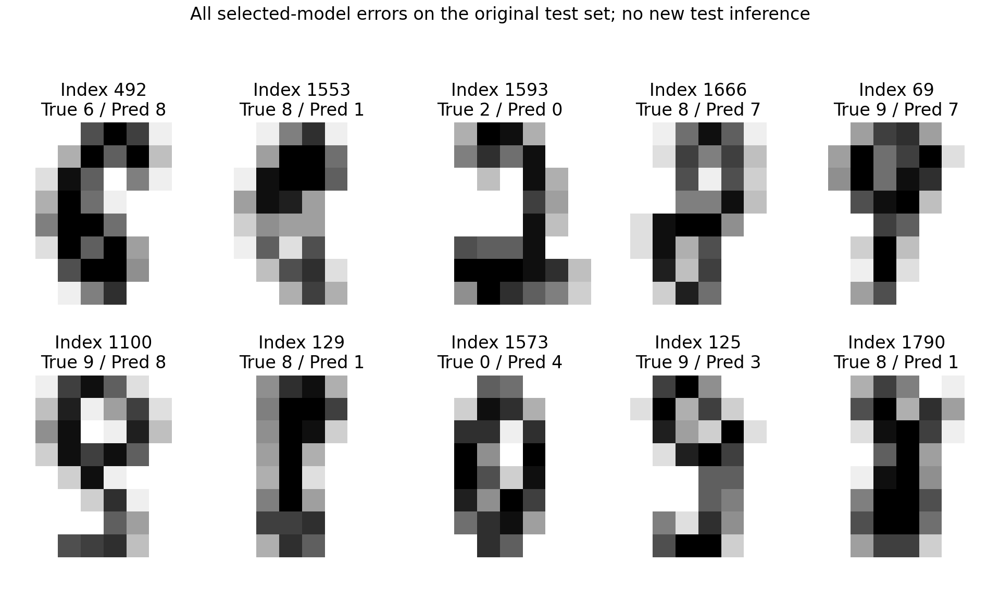
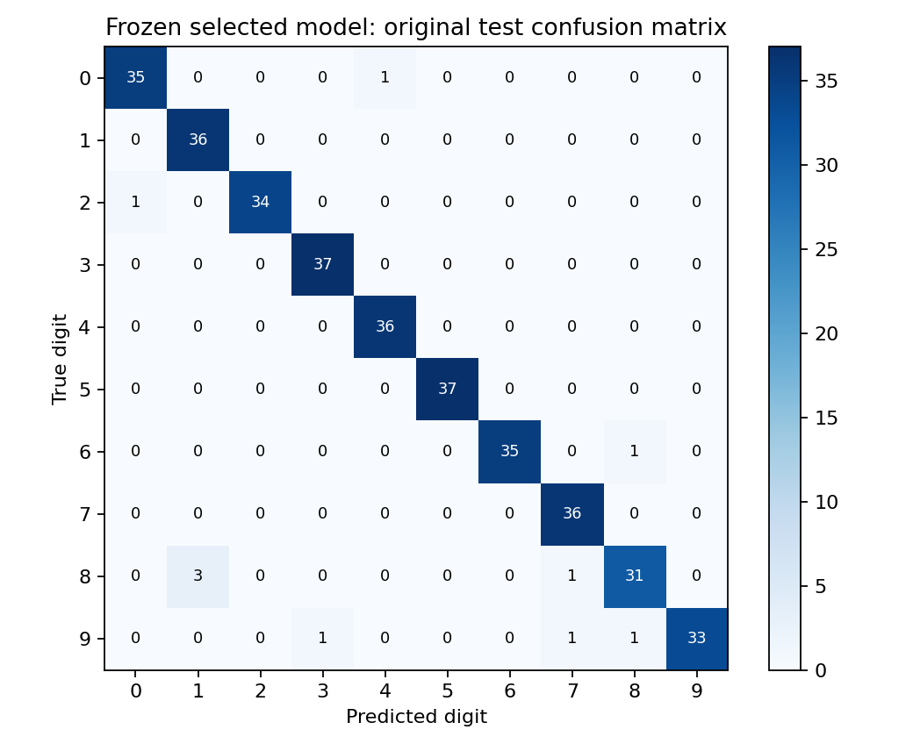

# Báo cáo checkpoint tuần học 10

- **Ngày thực hiện:** 09/11/2026.
- **Nội dung:** tái lập protocol đã khóa, đối chiếu kết quả và phân tích lỗi/giới hạn.
- **Người chạy phiên này:** Codex; chưa có xác nhận sinh viên đã tự chạy hoặc cô duyệt.
- **Báo cáo Word cập nhật:** `Bao_cao_Train_Validation_Test_Baselines_2026-11-09.docx`.

## 1 Việc mới thực hiện

1. Chạy lại 180 search trials vào `results/week10_2026-11-09/reproduction/`, cùng config/seed/folds và quy tắc epsilon.
2. Đối chiếu toàn bộ trials, đại diện, model và predictions với bộ gốc; giữ nguyên các số đo runtime thay vì ép khớp.
3. Lưu đầy đủ 10 mẫu test selected sai, ma trận nhầm lẫn, cặp nhầm và khoảng cách train–validation–test.
4. Bổ sung validator, tests và hướng dẫn sinh viên tự chạy; cập nhật Word bằng bản ngày 09/11, giữ bản 03/11.

Không điều chỉnh tham số, dữ liệu, epsilon hoặc chọn lại model theo các lỗi test. Test được tính lại trong lần tái lập là cùng holdout đã biết, không phải đánh giá độc lập mới.

## 2 Tái lập kết quả

Lệnh thực sự đã chạy:

```powershell
.\.venv\Scripts\python.exe -X utf8 -u run_experiment.py --config configs/experiment.json --output results/week10_2026-11-09/reproduction
```

Đối chiếu **181 bản ghi**: một baseline và **180 search trials**. Tham số, fold scores, tính khả thi và model size của từng trial khớp; sai số CV tối đa **0**.

Config, split, quyết định và toàn bộ test predictions khớp. Binary selected model khớp hash: **True**. Phiên bản thư viện khớp: **True**. Hash xác nhận **88 artifact cũ** không đổi.

Các file mới giữ riêng; model bàn giao và selection gốc không bị ghi đè.

## 3 Runtime và giới hạn phép đo

Runtime pipeline gốc: **431.21 giây**; tái lập: **855.77 giây**; tỷ số mới/cũ **1.98**.

| Phương pháp | Seed | CV search gốc giây | CV search tái lập giây |
|---|---:|---:|---:|
| random | 11 | 56.40 | 119.20 |
| random | 22 | 56.69 | 98.32 |
| random | 33 | 33.17 | 95.81 |
| tpe | 11 | 23.18 | 72.66 |
| tpe | 22 | 27.67 | 84.13 |
| tpe | 33 | 70.55 | 78.61 |

Runtime toàn pipeline bao gồm CV, refit, profiling/logging; bảng trên chỉ cộng phần CV. Latency median/p95 theo đại diện nằm trong `latency_comparison.csv`. Hai phiên khác ngày và tải nền, chỉ có một lần chạy lại nên chưa đủ ước lượng độ ổn định runtime hoặc kết luận tốc độ thuật toán.

Sau khi HPO kết thúc, đo riêng latency selected trên batch cố định 256 mẫu development: 5 rounds, 3 warmups/round và 15 phép đo/round (75 số đo). Median chung **20.8181 ms/batch**, p95 **84.0266 ms/batch**; mean ± SD của năm median **25.4926 ± 13.1721 ms**. Toàn bộ số đo được giữ, không loại outlier. Đây không phải single-request latency hay bằng chứng ổn định trên nhiều phiên/máy.



## 4 Toàn bộ lỗi selected trên test gốc

| Global index | Nhãn thật | Selected dự đoán | Random dự đoán | Random đúng |
|---:|---:|---:|---:|---|
| 492 | 6 | 8 | 4 | False |
| 1553 | 8 | 1 | 1 | False |
| 1593 | 2 | 0 | 2 | True |
| 1666 | 8 | 7 | 8 | True |
| 69 | 9 | 7 | 7 | False |
| 1100 | 9 | 8 | 8 | False |
| 129 | 8 | 1 | 1 | False |
| 1573 | 0 | 4 | 4 | False |
| 125 | 9 | 3 | 3 | False |
| 1790 | 8 | 1 | 1 | False |



| Nhãn thật | Nhãn dự đoán | Số lần |
|---:|---:|---:|
| 8 | 1 | 3 |
| 0 | 4 | 1 |
| 2 | 0 | 1 |
| 6 | 8 | 1 |
| 8 | 7 | 1 |
| 9 | 3 | 1 |
| 9 | 7 | 1 |
| 9 | 8 | 1 |

Random sửa đúng **2** lỗi selected nhưng sai thêm **1** mẫu selected đúng; có **8** lỗi chung. Các ảnh 8×8 cho thấy thông tin nét hữu hạn; nhận xét trực quan không phải chứng minh nguyên nhân sai.



## 5 Khoảng cách train validation test

| Đại diện | Train accuracy | Validation accuracy | Test accuracy | Train trừ val điểm phần trăm |
|---|---:|---:|---:|---:|
| default | 100.00% | 97.08% | 97.22% | 2.923 |
| random | 100.00% | 97.49% | 97.50% | 2.505 |
| tpe | 100.00% | 97.43% | 97.22% | 2.575 |
| selected | 100.00% | 97.08% | 97.22% | 2.923 |

Train là in-sample trên development đã fit. Validation là mean qua ba folds; CV đã tham gia tuning. Train 100% không chứng minh tổng quát hóa hoàn hảo. Test nhỏ và đã biết; không dùng các cặp nhầm để tuning lại.

## 6 Kiểm chứng và bằng chứng

```powershell
.\.venv\Scripts\python.exe -X utf8 -m src.validation --output results/week10_2026-11-09/reproduction
.\.venv\Scripts\python.exe -X utf8 -m src.week10 validate
.\.venv\Scripts\python.exe -X utf8 -m unittest discover -s tests -v
```

Pipeline tái lập đã chạy bộ kiểm chứng kết quả gốc (401 checks). Validator tuần 10 đối chiếu từng trial, cấu hình, fold scores, decisions, predictions, bảng phân tích lỗi và hashes. Tests mới phát hiện trial bị sửa/duplicate index, kiểm tra chiều cặp nhầm và cho phép runtime thực thay đổi.

Nguồn: thư mục `results/week10_2026-11-09/`, `src/week10.py`, `tests/test_week10.py`. Không chạy lại phần mở rộng 450 trials chỉ để bổ sung tài liệu tuần 10.

## 7 Phần sinh viên và giảng viên cần xác nhận

Sinh viên làm theo [hướng dẫn tự chạy](../docs/tu-chay-tai-lap-tuan-10.md), đọc log và giải thích kết quả. Phiên do trợ lý chạy không tự xác nhận sinh viên đã tự tái lập. Chưa có feedback hoặc duyệt checkpoint tuần 10 từ cô.

Tuần 11 còn kiểm tra cuối, chốt bản nộp/tag v1.0, tập demo/bảo vệ và nộp link. Chưa tạo release cuối hoặc đánh dấu nộp bài trong checkpoint này.

## 8 Xác minh sau khi hoàn thiện

Đã chạy **25 unit tests** đạt; bộ gốc **401 checks**, phần mở rộng **3.278 checks**, report evaluation, demo tuần 9 và validator tuần 10 đạt. Bản Word mới có **11 trang**, đã render và kiểm tra từng trang.

Renderer LibreOffice thiếu soffice.exe trên Windows; dùng Microsoft Word mở read-only, export PDF tạm và Poppler render PNG để kiểm tra. PDF/PNG QA ở ngoài repo, không phải file bàn giao.

Kết quả xác minh nằm trong `verification.json`; việc kiểm chứng của trợ lý không thay xác nhận sinh viên tự chạy hoặc giảng viên duyệt.
