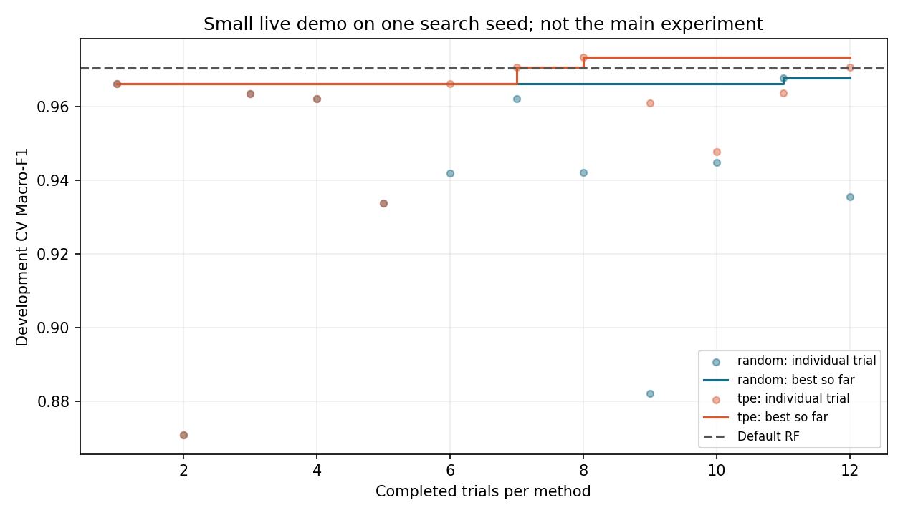

# Báo cáo tiến độ checkpoint tuần học 9

- **Ngày cập nhật:** 01/11/2026.
- **Môn học:** Nhập môn tối ưu hóa.
- **Đề tài:** Tối ưu siêu tham số Random Forest cho nhận dạng chữ số viết tay bằng Optuna: cân bằng chất lượng dự đoán và kích thước mô hình.
- **Repo:** [TienMoi79/digits-rf-optimization](https://github.com/TienMoi79/digits-rf-optimization).
- **Mốc chuẩn bị:** nội dung cho tuần học 9, làm ngày 01/11/2026 theo yêu cầu làm trước; hạn nộp theo thông tin sinh viên là tuần học 11.
- **Trọng tâm tuần học 9:** Làm rõ cơ chế toán học thuật toán Optuna TPE (phân bố $l(x)$ và $g(x)$, tiêu chuẩn Expected Improvement, vai trò của startup trials) và hoàn thiện kịch bản/công cụ Demo trực tiếp quy trình tối ưu 5–7 phút phục vụ bảo vệ cá nhân.
- **Trạng thái phê duyệt:** Đã triển khai và chạy thử; chưa xác nhận sinh viên tự demo hoặc giảng viên duyệt.

---

## 1. Phạm vi báo cáo tuần học 9 gửi cô kiểm tra

Báo cáo này kế thừa kết quả rà soát tuần 8 và tập trung giải quyết hai lỗ hổng lý thuyết và thực hành lớn nhất thường gặp trong Rubric chấm điểm:
1. **Lý thuyết tối ưu hóa:** Giải thích cặn kẽ nguyên lý của thuật toán Bayesian Optimization dạng **Tree-structured Parzen Estimator (TPE)**, làm rõ công thức toán học xác suất thay vì coi thư viện Optuna là "hộp đen".
2. **Kịch bản Demo tối ưu hóa 5–7 phút:** Bổ sung công cụ trình bày trực tiếp không gian tìm kiếm, điểm từng trial, best-so-far và quy tắc $\epsilon$-constraint. Thời lượng thực tế cần sinh viên tập thử, không bảo đảm chỉ từ việc code chạy được.

Báo cáo tiếp tục tuân thủ nguyên tắc: Không nộp Word/PDF/slide; sử dụng định dạng Markdown `.md` theo dõi tiến độ công khai trên GitHub; số liệu thực nghiệm được bảo toàn nguyên vẹn từ các file log đã được kiểm chứng.

---

## 2. Công việc thực hiện trong tuần học 9

| STT | Nội dung công việc | Mục tiêu & Chuẩn đầu ra | Bằng chứng kỹ thuật | Trạng thái |
|:---:|---|---|---|:---:|
| 1 | **Mô hình hóa lý thuyết TPE** | Diễn giải input/output, $l(x)$ và $g(x)$, tỷ số và EI | Mục 3, `docs/tpe-va-demo-toi-uu.md`, README | Đã bổ sung tài liệu; không sửa notebook gốc |
| 2 | **Đối chiếu kết quả TPE Startup** | Giải thích lại kết quả 5/10 startup từ 450 trials đã có | Dữ liệu `results/robustness/`, notebook mở rộng | Dùng kết quả cũ, không ghi là chạy mới tuần 9 |
| 3 | **Thiết kế công cụ & kịch bản Demo** | Xây dựng kịch bản demo 5–7 phút tập trung vào chuỗi tối ưu (Baseline $\to$ TPE $\to$ Epsilon filter $\to$ Selection) | Kịch bản Mục 4; script `demo_optimization.py` | Đã hoàn thành |
| 4 | **Live demo mới** | 12 trials/method, một seed, startup 5; chỉ development | `results/week9_demo/run-2026-11-01/` | Đã chạy 24 search trials và baseline |
| 5 | **Kiểm chứng tính toàn vẹn** | Tests, kiểm tra kết quả cũ và log demo | Mục 5; các validator và tests | Đạt các kiểm tra được liệt kê |

---

## 3. Cơ chế chuyên sâu của thuật toán Optuna TPE (Tree-structured Parzen Estimator)

### 3.1 Input, Output và Không gian tìm kiếm
* **Input của thuật toán:**
  * Không gian siêu tham số rời rạc $\Omega$ gồm 560 cấu hình khả thi:
    * $n\_estimators \in \{50, 75, 100, 125, 150, 175, 200\}$ (7 giá trị).
    * $max\_depth \in \{5, 10, 15, 20, \text{None}\}$ (5 giá trị).
    * $min\_samples\_leaf \in \{1, 2, 3, 4\}$ (4 giá trị).
    * $max\_features \in \{\text{'sqrt'}, \text{'log2'}, 0.5, 1.0\}$ (4 giá trị).
  * Lịch sử các phép thử đã chạy $\mathcal{D} = \{(x_1, y_1), (x_2, y_2), \dots, (x_i, y_i)\}$, trong đó $y_i = f(x_i)$ là điểm Macro-F1 CV trung bình qua 3 folds trên tập Development.
  * Ngân sách: 30 completed trials per seed; tham số khởi tạo `n_startup_trials`.
* **Output của thuật toán:**
  * Cấu hình đề xuất tiếp theo $x_{i+1} \in \Omega$ nhằm tối đa hóa hàm thu nhận kỳ vọng.

### 3.2 Tiếp cận mô hình xác suất của TPE so với Gaussian Process (GP)
Trong Tối ưu hóa Bayes truyền thống (dùng Gaussian Process), thuật toán mô hình hóa trực tiếp hàm mục tiêu $p(y \mid x)$ (mô hình hồi quy phi tham số).

Ngược lại, **TPE (Bergstra et al., 2011)** áp dụng quy tắc Bayes để mô hình hóa phân bố ngược $p(x \mid y)$ thông qua hai hàm mật độ xác suất riêng biệt:
$$p(x \mid y) = \begin{cases} l(x) & \text{nếu } y \ge y^* \text{ (nhóm quan sát đạt kết quả tốt)} \\ g(x) & \text{nếu } y < y^* \text{ (nhóm quan sát đạt kết quả kém)} \end{cases}$$

Trong đó:
* $y^*$ là ngưỡng phân nhóm, với $p(y \ge y^*) = \gamma$ trong mô hình lý thuyết. Không gán project dùng cố định 0.10 hoặc 0.15: code không truyền `gamma`, Optuna quyết định số trial nhóm tốt bằng quy tắc mặc định theo lịch sử đã hoàn thành.
* $l(x)$ là hàm mật độ xác suất của không gian tham số tạo ra bởi các điểm quan sát tốt nhất ($y \ge y^*$), được xấp xỉ bằng phương pháp ước lượng mật độ hạt nhân Parzen (Kernel Density Estimation - KDE).
* $g(x)$ là hàm mật độ xác suất tạo ra bởi các điểm quan sát còn lại ($y < y^*$).

### 3.3 Tối đa hóa Tiêu chuẩn Thu nhận Kỳ vọng (Expected Improvement - EI)
Tiêu chuẩn Expected Improvement đối với bài toán cực đại hóa mục tiêu (ở đây là Macro-F1) được định nghĩa là giá trị kỳ vọng của mức cải thiện so với ngưỡng $y^*$:
$$\text{EI}_{y^*}(x) = \mathbb{E}\left[\max(0, y - y^*) \mid x\right] = \int_{y^*}^{\infty} (y - y^*) p(y \mid x) dy$$

Áp dụng định lý Bayes $p(y \mid x) = \frac{p(x \mid y) p(y)}{p(x)}$, ta có:
$$\int_{y^*}^{\infty} (y - y^*) p(y \mid x) dy = \frac{\int_{y^*}^{\infty} (y - y^*) p(x \mid y) p(y) dy}{p(x)}$$

Vì theo định nghĩa $p(x \mid y) = l(x)$ khi $y \ge y^*$, nên:
$$\int_{y^*}^{\infty} (y - y^*) p(x \mid y) p(y) dy = l(x) \int_{y^*}^{\infty} (y - y^*) p(y) dy$$

Mặt khác, mẫu số $p(x)$ có thể phân rã toàn phần theo ngưỡng $y^*$:
$$p(x) = \int_{-\infty}^{\infty} p(x \mid y) p(y) dy = \int_{-\infty}^{y^*} g(x) p(y) dy + \int_{y^*}^{\infty} l(x) p(y) dy = g(x)(1 - \gamma) + l(x)\gamma$$

Kết hợp lại, ta thu được công thức then chốt của TPE:
$$\text{EI}_{y^*}(x) = \frac{l(x) \int_{y^*}^{\infty} (y - y^*) p(y) dy}{\gamma l(x) + (1 - \gamma) g(x)} \propto \left( \gamma + \frac{g(x)}{l(x)} (1 - \gamma) \right)^{-1}$$

Tích phân ở tử dùng mật độ biên $p(y)$ nên không nhân thêm $\gamma$ lần nữa.
Quan hệ trên thuộc mô hình mật độ và ngưỡng cố định; implementation đánh giá
một tập ứng viên hữu hạn, không giải chính xác argmax trên toàn bộ miền 560
cấu hình. Biến categorical dùng phân bố rời rạc phù hợp, không coi mọi biến
là một Gaussian. Nguồn: [TPE gốc, mục 4](https://papers.nips.cc/paper_files/paper/2011/file/86e8f7ab32cfd12577bc2619bc635690-Paper.pdf).

> **Ý nghĩa trực giác cốt lõi:** Để tối đa hóa Expected Improvement $\text{EI}(x)$, thuật toán chỉ cần **tối đa hóa tỷ số khả dĩ (Likelihood Ratio):**
> $$\arg \max_{x \in \Omega} \text{EI}(x) \equiv \arg \max_{x \in \Omega} \frac{l(x)}{g(x)}$$
> Nghĩa là tại mỗi bước lấy mẫu, TPE sẽ ưu tiên chọn cấu hình $x$ có xác suất cao xuất hiện ở nhóm điểm tốt $l(x)$ và xác suất thấp xuất hiện ở nhóm điểm kém $g(x)$.

### 3.4 Phân tích tham số khởi tạo `n_startup_trials`
* Khi study chưa có đủ số completed startup trials, Optuna lấy mẫu ngẫu nhiên theo phân bố khai báo trong search space. Các trial startup vẫn nằm trong tổng budget; với 10 startup, checkpoint 5 chưa cho thấy giai đoạn TPE thích nghi.
* **Kết quả nghiên cứu mở rộng (Robustness study trên 450 trials - 5 seeds):**
  * Ở ngân sách 30, mean best CV của startup 5 là 0.97442475; startup 10 là 0.97282371 trong năm seeds của lần chạy cũ.
  * Startup 5 hơn ở 3 seeds, hòa 2 seeds; delta trung bình khoảng 0.00160. Đây là mô tả trên cùng folds, không chứng minh startup 5 luôn hơn hoặc cả hai đã hội tụ toàn cục.
  * Có thêm trial ngẫu nhiên ban đầu không bảo đảm mẫu phủ đều hơn trong một lần chạy cụ thể. Phân tách test do protocol/objective quyết định, không do startup tự bảo đảm.

Phiên bản đã cài là Optuna 5.0.0: `multivariate=None` tự chọn True cho
single-objective. Thí nghiệm gốc không truyền cờ này; demo live ghi tường minh
True, `n_ei_candidates=24`, startup 5. Chi tiết input/output, lý do chọn TPE
và phiên bản ở [tài liệu kèm theo](../docs/tpe-va-demo-toi-uu.md).

---

## 4. Kịch bản và công cụ Demo tối ưu hóa 5–7 phút

Nhằm đáp ứng yêu cầu bảo vệ cá nhân và tránh lỗi bị trừ điểm do demo sai trọng tâm, kịch bản demo được thiết kế tập trung 100% vào **chuỗi logic tối ưu hóa**:

```
[Problem & Development] -> [Baseline & Space] -> [Replay/Live CV] -> [Epsilon Decision] -> [Log Validation]
```

### 4.1 Phân bổ thời gian chi tiết (Khung 5–7 phút)

| Mốc thời gian | Nội dung trình bày | Thao tác minh chứng trực tiếp |
|---|---|---|
| **Phút 0:00 – 1:30** | **Đặt vấn đề & Không gian tối ưu**<br>- Trình bày bài toán nhận dạng chữ số Digits (1.797 ảnh, 64 features).<br>- Giới thiệu vector 4 biến quyết định $x$ và không gian 560 cấu hình.<br>- Trình bày cấu hình Baseline (`n_estimators=100`, Macro-F1 $\approx 0.9706$, kích thước $4.98\text{ MB}$). | Mở file [`configs/experiment.json`](../configs/experiment.json) và chỉ rõ tham số cấu hình. |
| **Phút 1:30 – 3:30** | Giải thích tỷ số $l/g$; chạy replay checkpoint 5 rồi 15 và phân biệt điểm trial với best-so-far. Nếu đủ thời gian, chạy live nhỏ hoặc nói rõ đang xem log live đã chạy. | Replay chỉ đọc log; live thực sự fit. Không gọi replay là search đang huấn luyện. |
| **Phút 3:30 – 5:00** | **Cân bằng đa mục tiêu qua bài toán $\epsilon$-Constraint**<br>- Trình bày điểm cao nhất tìm được ($f^* \approx 0.9748$ của Random trial 21).<br>- Áp dụng ngưỡng $\epsilon = 0.005 \implies$ Ngưỡng chấp nhận $\ge 0.9698$.<br>- Lọc danh sách các mô hình khả thi thỏa mãn điều kiện.<br>- Giải thích quyết định chọn Baseline vì tiết kiệm **40.28% dung lượng** so với mô hình Random tốt nhất (4.98 MB vs 8.33 MB). | Mở file [`results/selection.json`](../results/selection.json) và đối chiếu bảng so sánh kích thước/hiệu năng. |
| **Phút 5:00 – 6:30** | Kiểm tra log demo: budget, fold mean, epsilon và bảo toàn kết quả. Bảng test gốc đã công bố chỉ là kết quả cũ, không đánh giá độc lập mới. | Chạy `demo_optimization.py validate`; `demo.py --index 123` nếu dùng chỉ minh họa dự đoán một mẫu, không chứng minh test accuracy. |
| **Phút 6:30 – 7:00** | Nêu giới hạn ngân sách, một seed demo và CV selection bias; không kết luận miền đã bão hòa. | Trả lời câu hỏi về TPE, epsilon và RF. |

### 4.2 Lệnh thực thi demo trên Windows Terminal

Để giảng viên và sinh viên có thể chạy kiểm chứng trực tiếp, các lệnh demo được thiết kế gọn nhẹ:

```powershell
# 1. Replay prefix từ log cũ, không fit và không ghi file
.\.venv\Scripts\python.exe -X utf8 demo_optimization.py replay --seed 11 --checkpoint 15

# 2. Chạy mới chỉ development; thư mục phải chưa tồn tại
.\.venv\Scripts\python.exe -X utf8 demo_optimization.py live --trials 12 --startup 5 --seed 11 --output results/week9_demo/run-moi

# 3. Kiểm tra demo ngày 01/11 đã lưu, không retrain
.\.venv\Scripts\python.exe -X utf8 demo_optimization.py validate --output results/week9_demo/run-2026-11-01
```

---

## 5. Kết quả kiểm tra tính toàn vẹn kỹ thuật trong tuần 9

Các kiểm thử tự động trên môi trường Python 3.12 kiểm tra các điều kiện cụ thể,
không chứng minh hệ thống hoàn hảo hoặc sinh viên đã tự demo thành công:

| Bộ kiểm tra | Lệnh thực thi | Kết quả thực tế | Ghi chú kiểm chứng |
|---|---|:---:|---|
| **Unit Tests** | `python -m unittest discover -s tests -v` | **21/21 PASSED** | Có thêm năm tests demo bên cạnh 16 tests trước đó |
| **Original Validation** | `python -m src.validation` | **401/401 PASSED** | Bảo toàn tính bất biến của bộ kết quả gốc 180 trials |
| **Robustness Validation** | `python -m src.robustness_validation` | **3.278/3.278 PASSED** | Bảo toàn kết quả nghiên cứu mở rộng 5 seeds |
| **Report Facts Check** | `python -m src.report_facts --check` | **PASSED** | Chỉ kiểm tra vùng số liệu tự sinh trong báo cáo tuần 8, không phải mọi câu của mọi báo cáo |
| **Live demo validation** | `python demo_optimization.py validate --output results/week9_demo/run-2026-11-01` | **PASSED** | 24 trials, quyết định epsilon khớp, 75 artifacts cũ bảo toàn |

### 5.1 Lần chạy live mới ngày 01 tháng 11

| Đại lượng riêng demo | Kết quả từ logs |
|---|---:|
| Development / CV folds | 1.437 mẫu / 3 folds gốc |
| Budget / search seed / startup | 12 trials mỗi phương pháp / 11 / 5 |
| Search trials ngoài baseline | 24 |
| Best CV Random | 0.96788949 |
| Best CV TPE | 0.97342882 |
| CV selected của demo | 0.97061552 |
| Ngưỡng epsilon của demo | 0.96842882 |
| Model bytes selected | 4.975.993 byte |
| Runtime phiên chạy | Khoảng 103,40 giây |
| Artifact cũ bảo toàn theo hash | 75 |
| Số đánh giá mới trên test | 0 |

Log nằm trong `results/week9_demo/run-2026-11-01/`, gồm `trials.json`,
`demo_selection.json`, `run_manifest.json` và hình bên dưới. Baseline được
chọn từ tập ứng viên của riêng demo; model bàn giao không bị thay thế.
TPE có 7 trial sau startup; không dùng một seed nhỏ để kết luận thắng chung.

Trong manifest, `config` kế thừa RF/CV gốc và đổi profiling repeats thành 3;
budget/startup/search seed live nằm ở các trường riêng của manifest. Không
trộn runtime này với thí nghiệm gốc dùng 15 profiling repeats hoặc nghiên cứu
mở rộng CV-only. Replay chỉ một seed/prefix không tái hiện tập ứng viên gộp
ba seeds của `results/selection.json`; kịch bản mở selection gốc phải nói rõ
đang xem quyết định cũ, không phải quyết định riêng từ replay.



Đường bậc dùng cumulative maximum nên không giảm; các chấm giữ nguyên dao
động trial thật. Validator không refit tất cả trial, chỉ kiểm tra tính nhất
quán logs/quy tắc/hash. Các điểm giả lập trong unit tests chỉ nằm ở thư mục
tạm, không phải số liệu thật trong bảng demo này.

---

## 6. Kế hoạch hoàn thiện tuần học 10 và tuần học 11

| Tuần học | Trọng tâm công việc | Sản phẩm / Bằng chứng kiểm tra | Trạng thái |
|---|---|---|:---:|
| **Nội dung chuẩn bị tuần 9** | Hoàn thiện lý thuyết TPE ($l(x), g(x)$, EI); xây dựng kịch bản và công cụ demo | Báo cáo, script, log mới và checks | **Đã triển khai/chạy thử ngày 01/11; chưa xác nhận sinh viên tự demo hoặc cô duyệt** |
| **Tuần 10** | Sinh viên tự chạy tái lập thực nghiệm vào một thư mục mới độc lập; phân tích chi tiết ma trận nhầm lẫn (confusion matrix) và các ca phân loại sai (failure cases); phân tích độ ổn định thời gian chạy | Log tái lập mới độc lập (`results/reproduction-01/`); báo cáo phân tích lỗi nhận dạng chữ số | Dự kiến |
| **Tuần 11 (Nộp bài)** | Kiểm tra tổng duyệt toàn bộ repository; chốt mô hình và cấu hình chính thức; gắn Git Tag `v1.0`; sinh viên luyện tập bảo vệ cá nhân | Release `v1.0` trên GitHub; đường dẫn repo public; hoàn tất bảo vệ | Dự kiến |

---

## 7. Các điểm kính nhờ cô góp ý cho tuần học 9

1. **Về phần chứng minh lý thuyết TPE:** Cách diễn giải xác suất Bayes, hàm mật độ $l(x), g(x)$ và việc chuyển đổi Expected Improvement thành cực đại hóa tỷ số Likelihood Ratio $\frac{l(x)}{g(x)}$ đã đủ chi tiết và chuẩn xác về mặt toán học theo yêu cầu của môn học chưa ạ?
2. **Về kịch bản Demo 5–7 phút:** Kịch bản demo tập trung vào 5 bước (Không gian tìm kiếm $\to$ Quá trình sampling $\to$ Lọc $\epsilon$-constraint $\to$ Ra quyết định chọn mô hình $\to$ Kiểm tra tập Test) có đáp ứng đúng mong đợi của cô cho buổi bảo vệ cá nhân không ạ?
3. **Về tham số `n_startup_trials`:** Việc đối chiếu hai cấu hình startup 5 và 10 trials trong nghiên cứu mở rộng đã đủ để làm rõ tính chất của giai đoạn thăm dò (exploration) trước khi khai thác (exploitation) của TPE chưa ạ?
4. **Về kế hoạch tuần 10:** Trong tuần 10, cô có yêu cầu phân tích cụ thể hơn về những cặp chữ số dễ bị nhận dạng nhầm nhất (ví dụ số 1 và số 7, số 3 và số 8) khi thu gọn mô hình không ạ?

---

## 8. Bảng theo dõi phản hồi và sửa đổi

| Mã phản hồi | Nội dung cô góp ý | Cách xử lý & Artifact cập nhật | Kết quả kiểm tra sau sửa | Trạng thái |
|:---:|---|---|---|:---:|
| *FB-W9-01* | *(Chờ phản hồi thực tế từ cô về báo cáo tuần 9)* | *(Sẽ cập nhật chi tiết sau khi nhận ý kiến)* | *(Chạy lại kiểm chứng)* | Chờ phản hồi |

---

## 9. Nguồn tài liệu tham khảo và công cụ hỗ trợ

1. Bergstra, J., Bardenet, R., Bengio, Y., & Kégl, B. (2011). *Algorithms for hyper-parameter optimization*. Advances in Neural Information Processing Systems (NeurIPS 2011), 24.
2. Akiba, T., Sano, S., Yanase, T., Ohta, T., & Koyama, M. (2019). *Optuna: A next-generation hyperparameter optimization framework*. Proceedings of the 25th ACM SIGKDD International Conference on Knowledge Discovery & Data Mining, 2623–2631.
3. Scikit-learn Documentation: [Ensemble methods - Random Forests](https://scikit-learn.org/stable/modules/ensemble.html#forest) & [Optical Recognition of Handwritten Digits dataset](https://scikit-learn.org/stable/datasets/toy_dataset.html#digits-dataset).
4. GitHub Repository dự án: [TienMoi79/digits-rf-optimization](https://github.com/TienMoi79/digits-rf-optimization).
5. [Tài liệu Optuna TPESampler](https://optuna.readthedocs.io/en/stable/reference/samplers/generated/optuna.samplers.TPESampler.html).
6. Công cụ AI hỗ trợ: Codex hỗ trợ viết code, tài liệu, chạy live demo và kiểm thử. Sinh viên cần tự chạy và giải thích; việc sinh viên đã tự kiểm chứng hoặc cô duyệt chưa được xác nhận. Sinh viên cho phép push ngày 01/11 sau yêu cầu local ban đầu; không thay ngày thực hiện theo ngày dự kiến bảo vệ.
